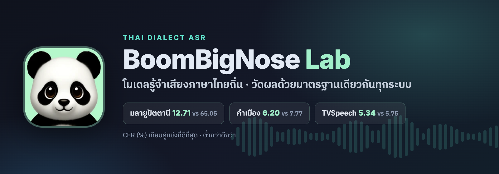

<div align="center">



# Thai Dialect ASR

**โมเดลรู้จำเสียงภาษาไทยถิ่น และชุดวัดผลมาตรฐานเดียวสำหรับ ASR ภาษาไทย** · โดย BoomBigNose Lab

[](LICENSE)
[](#สัญญาอนุญาต)
[](https://huggingface.co/BoomBigNoseLab)

</div>

---

## ภาพรวม

โปรเจกต์นี้มีสองส่วน

1. **ชุดวัดผล eval_v2** ใช้วัดทุกระบบด้วยกติกาเดียวกันทั้งหมด ได้แก่ การทำข้อความให้เป็นมาตรฐาน, การถอดแบบ greedy, การตัดเสียงยาว และ CER ระดับคลัง แต่ละชุดกติกามีค่า hash ตรวจสอบได้ ใช้กับชุดทดสอบภาษาไทย 8 ชุด ทั้งภาษาไทยกลางและภาษาถิ่น
2. **โมเดลภาษาถิ่น** สร้างบน w2v-BERT 2.0 แบบ CTC และ character n-gram LM เมื่อวัดด้วยกติกาเดียวกันกับโมเดลเปิดของไทยทุกตัวที่หาได้ ผลคือ **ชนะขาดในภาษามลายูปัตตานีและคำเมือง**

> "ชนะขาด" หมายถึง CER ต่ำกว่าคู่แข่งที่ดีที่สุดอย่างน้อย 10% แบบสัมพัทธ์ และช่วงความเชื่อมั่น 95% ของ paired bootstrap ต้องต่ำกว่าศูนย์ทั้งช่วง

## ผลลัพธ์หลัก

CER (%) บนชุดทดสอบ ยิ่งต่ำยิ่งดี ทุกระบบวัดใหม่ด้วย protocol `f1f03f053b40`

| ชุดทดสอบ | ของเรา | คู่แข่งที่ดีที่สุด | ผล |
|---|---:|---:|---|
| มลายูปัตตานี | **12.71** ✅ | 65.05 | 🏆 ชนะขาด −80% |
| คำเมือง (+LM) | **6.20** | 7.77 | 🏆 ชนะขาด −20% |
| คำเมือง (greedy) | 6.79 ✅ | 7.77 | ดีกว่า −13% (ไม่มีนัยสำคัญ) |
| TVSpeech | **5.34** | 5.75 | ชนะ −7% |
| โคราช | 13.45 | 13.38 | เสมอ |
| Common Voice 17 | 2.18 | 2.03 | แพ้ +8% |
| GigaSpeech2 | 4.75 | 4.52 | แพ้ +5% |

คู่แข่งที่ดีที่สุดในแต่ละชุด:
- มลายูปัตตานี: typhoon-asr-qwen-1.7b-ctx
- คำเมือง: Pathumma-whisper-large-v3
- TVSpeech และ GigaSpeech2: typhoon-whisper-large-v3
- โคราช และ Common Voice: Pathumma-stt-rnnt

✅ = น้ำหนักโมเดลเปิดให้ดาวน์โหลดบน Hugging Face

ตารางเต็ม พร้อมช่วง CI95 และแถวที่ยังรอตรวจสอบ อยู่ใน [`results/scoreboard.csv`](results/scoreboard.csv)

**ผลที่ยังรอตรวจสอบ:** อีสานผ่าน router (6.14 เทียบ 8.02) และ FLEURS แบบ style-invariant (5.30 เทียบ 5.66) ใช้โมเดล dialect2v2-interp ซึ่งตอนเลือกน้ำหนักผสมใช้ผลจากชุดทดสอบ TVSpeech ประกอบการตัดสินใจ จึงต้องเลือกใหม่บน dev ก่อน นอกจากนี้ผู้พูดทั้ง 114 คนในชุดทดสอบอีสานยังอยู่ในชุดเทรนอีสานที่ใช้ด้วย (เฉพาะผู้พูดที่ไม่เคยเห็นได้ 8.50) ระหว่างนี้เรา **ไม่นับ** สองแถวนี้เป็นผลชนะ

## โมเดลที่เปิดให้ใช้

| โมเดล | ภาษา | ฐาน | CER บนชุดทดสอบ |
|---|---|---|---|
| [`BoomBigNoseLab/w2v-bert-thai-pattani-ctc`](https://huggingface.co/BoomBigNoseLab/w2v-bert-thai-pattani-ctc) | มลายูปัตตานี (อักษรไทย) | facebook/w2v-bert-2.0 | 14.57 greedy / 12.71 + LM (มี LM ใน repo) |
| [`BoomBigNoseLab/w2v-bert-thai-khummuang-ctc`](https://huggingface.co/BoomBigNoseLab/w2v-bert-thai-khummuang-ctc) | คำเมือง (ไทยถิ่นเหนือ) | facebook/w2v-bert-2.0 | 6.79 greedy |
| [`BoomBigNoseLab/whisper-large-v3-thai-merge`](https://huggingface.co/BoomBigNoseLab/whisper-large-v3-thai-merge) | ไทยกลาง | task-arithmetic merge ของ Typhoon/Pathumma/Thonburian | TVSpeech 5.34 |
| [`BoomBigNoseLab/whisper-large-v3-thai-cv`](https://huggingface.co/BoomBigNoseLab/whisper-large-v3-thai-cv) | ไทยกลาง อ่านออกเสียง | เทรนต่อจาก merge ด้วย CV17 | CV 2.18 / GS2 4.75 |
| [`BoomBigNoseLab/whisper-large-v3-thai-korat`](https://huggingface.co/BoomBigNoseLab/whisper-large-v3-thai-korat) | โคราช | typhoon-whisper-large-v3 | 15.95 greedy / 13.45 ระบบเต็ม (มี LM ใน repo) |
| [`BoomBigNoseLab/whisper-large-v3-thai-dialects-interp`](https://huggingface.co/BoomBigNoseLab/whisper-large-v3-thai-dialects-interp) | ไทยกลาง + ถิ่น (รุ่นวิจัย) | merge + dialect fine-tune | อีสาน 6.14 (รอตรวจสอบ) |

โมเดลไทยกลาง (merge, cv) ใช้ Apache-2.0 ส่วนโมเดลที่เทรนด้วยข้อมูล SLSCU ใช้ CC BY-NC-SA 4.0

LM ของคำเมืองที่ทำให้ได้ 6.20 **ไม่ได้แจกจ่าย** เพราะข้อความที่ใช้สร้างมีส่วนที่ใช้ได้เพื่อการวิจัยเท่านั้น สร้าง LM เองได้ด้วย `KNTokenLM` ใน `src/bignose_thai_asr/ngram.py`

## เริ่มใช้งาน

```bash
git clone https://github.com/Boom-Vitt/thai-dialect-asr.git
cd thai-dialect-asr
pip install -e .
```

ถอดเสียง โดยไฟล์เสียงจะถูกแปลงเป็น 16 kHz mono ให้อัตโนมัติ:

```bash
# greedy
python scripts/transcribe.py --model BoomBigNoseLab/w2v-bert-thai-khummuang-ctc audio.wav

# CTC prefix beam + character 6-gram LM (ค่าที่เลือกบน dev)
python scripts/transcribe.py --model BoomBigNoseLab/w2v-bert-thai-pattani-ctc \
  --lm lm/pattani.char6.json.gz --lm-w 0.3 --bonus 1.0 --beam 8 audio.wav
```

เดโมบนเครื่อง (หน้าเว็บ อัดเสียงหรืออัปโหลดไฟล์ แล้วเลือกโมเดล):

```bash
pip install "gradio==5.50.0"
python demo/app.py   # เปิด http://127.0.0.1:7860
```

## วัดผลด้วย eval_v2

```bash
python scripts/eval_v2.py run --run my-run --models "mine=whisper:/path/to/model" --datasets fleurs cv
python scripts/paired_bootstrap.py ours.jsonl theirs.jsonl --json
python scripts/style_invariant.py --ref-system pathumma pathumma=a.jsonl mine=b.jsonl
```

กติกาของ protocol:
- **การทำข้อความให้เป็นมาตรฐาน:** ใช้แบบเดียวกันทั้งเฉลยและผลถอด ได้แก่ NFC, ตัด zero-width, เลขไทยเป็นเลขอารบิก, `pythainlp` normalize และแปลงเครื่องหมายวรรคตอนเป็นช่องว่าง
- **CER:** คิดหลังลบช่องว่างทั้งหมด ระดับคลัง (ผลรวมจุดผิด ÷ ผลรวมตัวอักษรเฉลย)
- **การถอด:** greedy ไม่มี LM ไม่มี repetition penalty, `language=th`
- **เสียงยาวเกิน 30 วินาที:** ตัดด้วย chunker เดียวกันสำหรับทุกโมเดล
- **style-invariant:** แปลงตัวเลขเป็นคำอ่านและขยายไม้ยมก ทั้งเฉลยและผลถอด ใช้รายงานคู่กับ CER ดิบเสมอ ไม่ใช้แทน
- **นัยสำคัญ:** paired bootstrap 2,000 รอบ รายงานช่วง CI95 ของ (ของเรา − คู่แข่ง)

## วิธีการโดยย่อ

- **มลายูปัตตานี:** w2v-BERT 2.0 character CTC เทรนร่วมสามสำเนียงของ SLSCU พร้อม head ระบุสำเนียง เลือก checkpoint บน dev ปัตตานี แล้วถอดด้วย CTC prefix beam (กว้าง 8) ร่วมกับ character 6-gram LM จากข้อความเทรน
- **คำเมือง:** เทรนต่อจากโมเดลข้างบนเฉพาะคำเมือง ใช้ speed perturbation และเฉลี่ย 3 checkpoint ที่ดีที่สุดบน dev
- **การคัดเลือก:** ทุกค่า (checkpoint, น้ำหนัก LM, beam) เลือกบน dev เท่านั้น และอ่านชุดทดสอบครั้งเดียว
- **กันข้อมูลรั่ว:** ข้อมูลเทรนผ่านการกรองซ้ำกับเฉลยของชุดทดสอบและ dev ทุกชุด ทั้งแบบตรงตัวและใกล้เคียง

รายละเอียดอยู่ใน [ร่าง paper](paper/paper-draft.md)

## ข้อจำกัดและการเปิดเผยข้อมูล

- **ชุดทดสอบ SLSCU:** คือชุด dev ที่ SLSCU เผยแพร่ เพราะคลังนี้ไม่มีชุดทดสอบสาธารณะ ส่วน dev ที่เราใช้เลือกโมเดลแยกออกมาจากชุดเทรน
- **ESPnet ของ SLSCU:** ได้ 5.22 ในคำเมือง และ 11.77 ในโคราช แต่ config ของโมเดลนี้เลือก checkpoint บนชุดเดียวกับที่เราใช้เป็นชุดทดสอบ เราจึงรายงานเป็นค่าอ้างอิงเท่านั้น ไม่นับเป็นคู่แข่ง
- **ผู้พูดซ้ำ:** ยังตรวจไม่ได้ว่าผู้พูดในชุดเทรนกับชุดทดสอบของ SLSCU ซ้ำกันหรือไม่
- **ภาษาไทยกลาง (CV, GigaSpeech2):** ยังแพ้คู่แข่งที่เทรนด้วยข้อมูลมากกว่า เราลองวิธีเสริมแบบไม่แพงแล้ว 6 วิธี ไม่มีวิธีไหนช่วยบนชุดทดสอบ (ดู paper หัวข้อ 6)

## สัญญาอนุญาต

- **โค้ด:** Apache-2.0
- **น้ำหนักโมเดลและ LM:** CC BY-NC-SA 4.0 เพื่อการวิจัยและไม่ใช่เชิงพาณิชย์ ตามเงื่อนไขของข้อมูลฝึก (SLSCU Thai Dialect Corpus ผ่าน CMKL/Porjai, CC BY-NC-SA 4.0) โมเดลฐาน w2v-BERT 2.0 ใช้ MIT

## การอ้างอิง

ดู [`CITATION.cff`](CITATION.cff)

```bibtex
@misc{thai_dialect_asr_2026,
  title        = {Thai Dialect ASR: Same-Protocol Benchmarking of Central and Regional Thai Speech Recognition},
  author       = {{BoomBigNose Lab}},
  year         = {2026},
  howpublished = {\url{https://github.com/Boom-Vitt/thai-dialect-asr}}
}
```

## ขอบคุณ

- SLSCU Thai Dialect Corpus
- Typhoon (SCB 10X)
- Pathumma (NECTEC)
- Thonburian Whisper
- Meta w2v-BERT 2.0
- PyThaiNLP
- ผู้ร่วมสร้าง Common Voice, FLEURS, GigaSpeech2 และ TVSpeech
